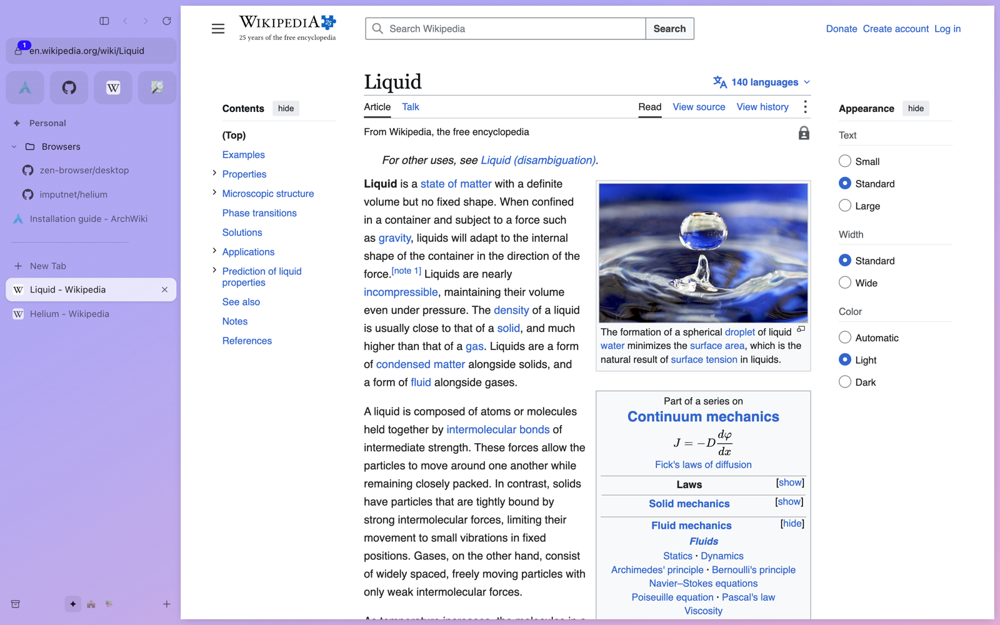
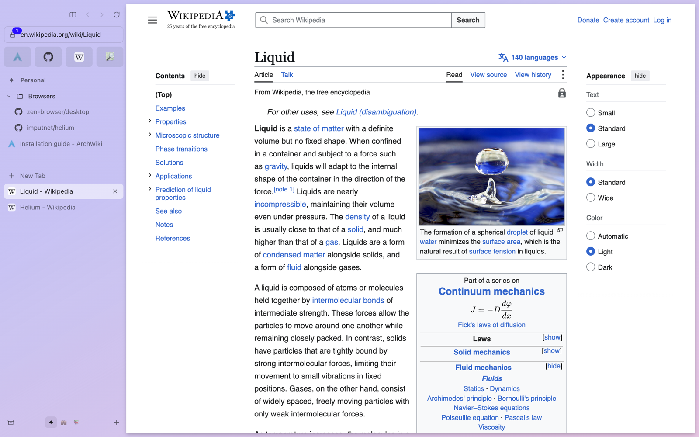
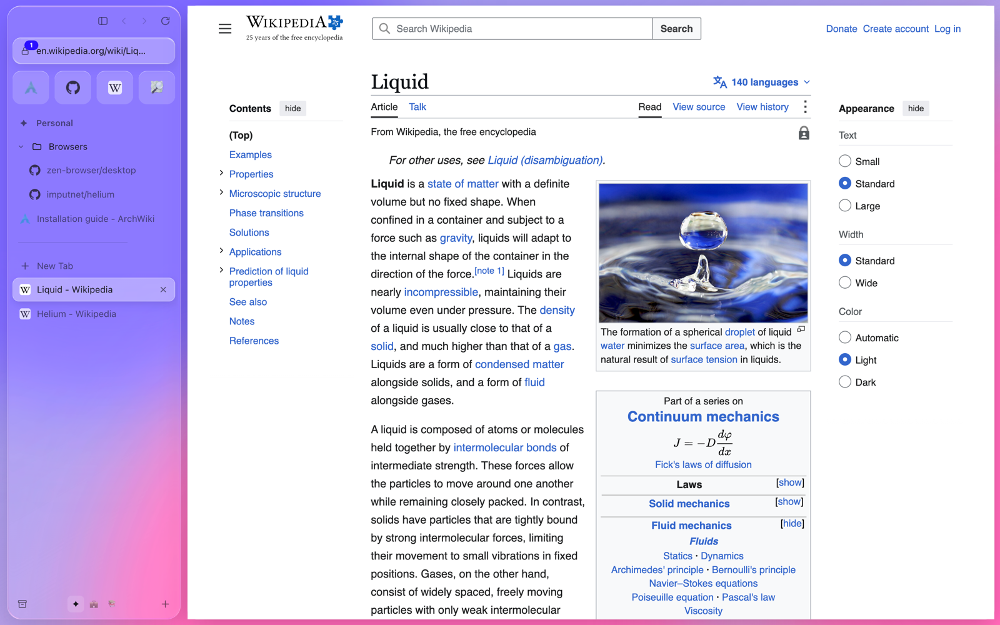
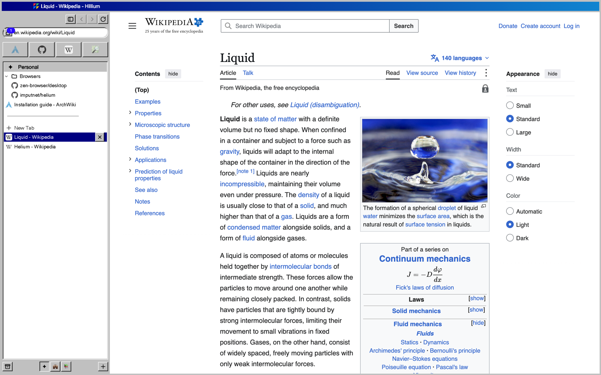

<p align="center"></p>

<h1 align="center">Hillium</h1>

<p align="center">An Arc and Zen style browser with Helium's privacy defaults, for Linux (Arch) and macOS.</p>

<p align="center"></p>

Hillium puts your tabs in a sidebar on a coloured space, the way Arc and Zen do. Favourites sit on top, pinned tabs and folders under them, and today's tabs below; those clear themselves after a while. ⌘T opens a liquid-glass command bar that searches every tab in every space. Privacy works like Helium: ads and trackers are blocked, nothing goes to Google, HTTPS comes first, and third parties get no cookies.

It runs on Electron's Chromium rather than a Helium build. [docs/helium-parity.md](docs/helium-parity.md) lists which Helium defaults that covers and which it doesn't.

<p align="center"></p>

<!-- run-steps:start -->
## Run it locally, step by step

1. **Install [Node.js](https://nodejs.org) 24** or newer.

2. **Get the code:**

   ```sh
   git clone https://github.com/Gitguy268/hillium.git
   cd hillium
   ```

3. **Start it:**

   ```sh
   cd app
   npm ci
   npm start
   ```

   On a Mac you can double-click `app/start.command` instead. The first run installs Electron.

4. **Quit** with `Cmd+Q` on macOS or by closing the window.
<!-- run-steps:end -->

## Install

**Arch Linux**

```sh
git clone https://github.com/Gitguy268/hillium && cd hillium/app
npm ci && npm run dist:linux                 # dist/hillium-0.1.0-x64.tar.gz (and -arm64)
cp dist/hillium-*.tar.gz ../packaging/arch/ && cd ../packaging/arch
makepkg -si                                  # installs hillium-bin: /usr/bin/hillium, hillium-cli
```

Hillium starts on Wayland when there is one and on X11 otherwise. Extra Chromium flags go in `~/.config/hillium-flags.conf`, one per line. To make it the default browser: Settings › System › Make default, or `xdg-settings set default-web-browser hillium.desktop`.

**macOS**

Double-click `app/start.command`, or run `cd app && npm ci && npm start` (Node 24). The first run installs Electron and the ad blocker, about 350 MB. `npm run dist:mac` builds an unsigned `Hillium.app` in `app/dist/`.

**Import** your spaces from Arc or Zen, or bookmarks from Chrome, Brave, Helium, Vivaldi or Chromium, in Settings › Import.

## What's in it

| | |
|---|---|
| **Spaces** | Each with a name, an emoji and a colour gradient picked on Zen's colour wheel. Switch with a two-finger swipe on the sidebar, ⌃1–9, or the dots at the bottom. A space can have its own cookies and logins |
| **Favourites** | A grid of icons above every space |
| **Pinned and Today** | Pinned tabs and folders stay. Today tabs go to the archive after 12 hours, a day or a week (your choice), and "Clear" sends them there now. Drag tabs between all three |
| **Command bar** | ⌘T: fuzzy search over open tabs in every space, history, the archive, spaces and commands. ⌘L edits the address |
| **Glance and Peek** | ⌥-click a link to open it in a floating card. Links from a pinned tab to another site open there too. Open it as a tab or next to the page |
| **Split view** | Up to four pages side by side. Drag a tab onto the page, or ⌃⇧= |
| **Compact mode** | ⌘S hides the sidebar; move to the left edge and it slides over the page |
| **Boosts and Zap** | Your own CSS, JavaScript and font per site, and click-to-hide for anything on a page |
| **Little Hillium** | Links from other apps open in a small window; one click moves the page into your main window. Space rules send matching links straight to a space |
| **Library** | Archived tabs, history, downloads, ArchiveBox copies and Boosts |
| **Looks** | Arc, Zen, Liquid Glass and Retro 98 |
| **Agents** | The `hillium` CLI and an MCP server let AI apps list, open and read your tabs, if you turn it on. Private windows stay invisible |

<details>
<summary><b>The four looks</b></summary>

| Arc | Zen |
|---|---|
|  |  |
| **Liquid Glass** | **Retro 98** |
|  |  |

The glass is real refraction: an SVG displacement map computed for each panel's shape, used as a `backdrop-filter` ([archisvaze/liquid-glass](https://github.com/archisvaze/liquid-glass), MIT). It works on Linux too, because it doesn't depend on the window system. Retro 98 is CSS only, with no Windows artwork or fonts.

</details>

<details>
<summary><b>Privacy</b></summary>

- **Blocking:** Ghostery's engine with EasyList, EasyPrivacy, uBlock Origin's lists and cookie notices. The lock left of the address shows the count for the page and turns blocking or cookie blocking off per site.
- **Clean links:** 68 tracking parameters (`utm_*`, `fbclid`, `gclid`…) are removed before a page loads.
- **HTTPS first:** http addresses are tried over HTTPS; a site without it gets a page that offers http and remembers your choice.
- **Third parties** get no cookies and only the site you came from, not the page.
- **Global Privacy Control**, no link-tracking pings, WebRTC kept to the public interface, **DNS over HTTPS** (Quad9 by default; Mullvad, Cloudflare or off).
- **No Google:** a whole e2e run touches only GitHub (the filter lists) and Quad9 (DNS).
- **Not included:** fingerprint noise like Helium's or Brave's. Use Tor Browser when you need to be anonymous.

- **Partitioning:** caches, connections and storage are kept per site, so a tracker embedded on two sites can't recognise you through them.

On a subset of [privacytests.org](https://privacytests.org)'s tests Hillium passes 67 of 76; Electron with its defaults passes 11 of 63. [docs/privacy-results.md](docs/privacy-results.md) has the table, including what still fails: the CSS, font, image, script, prefetch and favicon caches, `document.referrer`, `window.name`, and "Tor enabled" (there's no Tor).

</details>

<details>
<summary><b>Keyboard shortcuts</b></summary>

On Linux, ⌘ is Ctrl, ⌥ is Alt, and spaces use Alt+1–9.

| Action | Shortcut |
|---|---|
| Command bar / edit address | ⌘T / ⌘L |
| Close tab / reopen | ⌘W / ⇧⌘T |
| Pin or unpin / add to favourites | ⌘D / ⇧⌘D |
| Toggle sidebar | ⌘S |
| Tab 1–9 / space 1–9 | ⌘1–9 / ⌃1–9 |
| Next / previous tab | ⌃Tab / ⌃⇧Tab |
| Next / previous space | ⌃⌥→ / ⌃⌥← |
| Split with the next tab / leave split | ⌃⇧= / ⌃⇧- |
| Find | ⌘F |
| Copy address | ⇧⌘C |
| Archive page in ArchiveBox | ⇧⌘S |
| Zap an element / boost this site | ⌥⌘Z / ⌥⌘B |
| New window / private window / Little Hillium | ⌘N / ⇧⌘N / ⌥⌘N |
| Library / settings | ⌘Y / ⌘, |

</details>

<details>
<summary><b>The CLI and AI agents</b></summary>

Turn on Settings › Agents › "Allow the CLI and AI agents". Hillium then listens on a Unix socket in its profile folder that only you can open.

```sh
hillium-cli tabs                      # (node cli/hillium.mjs on macOS)
hillium-cli open https://example.com --space Work
hillium-cli text                      # the active page's text
hillium-cli tabs --json               # everything has --json
```

For Claude, Cursor or another MCP client, add a stdio server that runs `hillium-cli mcp`. It offers `list_tabs`, `open_tab`, `get_page_text`, `get_page_links`, `click`, `type_text`, `screenshot`, `search_history`, `archive_page` and a few more.

</details>

<details>
<summary><b>ArchiveBox</b></summary>

Point Settings › ArchiveBox at your [ArchiveBox](https://github.com/ArchiveBox/ArchiveBox) (0.8 or later) and paste an API key from its admin page. ⇧⌘S, the site panel or the command bar then sends the page there, and the Library lists what you sent.

</details>

<details>
<summary><b>How it fits together</b></summary>

See [docs/architecture.md](docs/architecture.md). In short: a transparent window UI, one Chromium view per visible tab placed in the card, a single request filter per session, `hillium://` pages with a token-checked API, and a plain-data model of spaces and tabs that the tests drive directly. Security: [docs/security.md](docs/security.md).

</details>

## Limits

- **It's Electron, not Helium.** Chromium updates arrive with Electron releases, and there's no fingerprint noise. [docs/roadmap.md](docs/roadmap.md) describes a Helium-based build for later.
- **No Chrome extensions, password saving or sync** yet.
- **Unsigned on macOS.** Right-click › Open the first time.
- **Arc wasn't decompiled.** Its features are rebuilt from how Arc behaves; Arc is closed source.

## Development

```sh
cd app
npm ci
npm start
npm test                       # unit tests: model, privacy filter, importers, socket, CLI/MCP, ArchiveBox
npm run lint
PLAYWRIGHT=/path/to/node_modules/playwright npm run e2e          # 25 checks against the real app
PLAYWRIGHT=/path/to/node_modules/playwright sh test/arch/run.sh  # makepkg + the e2e in an Arch Linux container
PLAYWRIGHT=/path/to/node_modules/playwright npm run privacy      # privacytests.org subset
```

See [CONTRIBUTING.md](CONTRIBUTING.md).

## Credits and licence

MIT, © Lucas Van De Weerd. The files in `app/ui/vendor/zen/` come from [Zen](https://github.com/zen-browser/desktop) and stay MPL-2.0; `app/ui/vendor/glass/` is MIT by Archis Vaze. [NOTICE](NOTICE) lists everything Hillium uses and every project it took ideas from. Hillium isn't affiliated with The Browser Company, Zen, imputnet (Helium), Brave or Ghostery.
